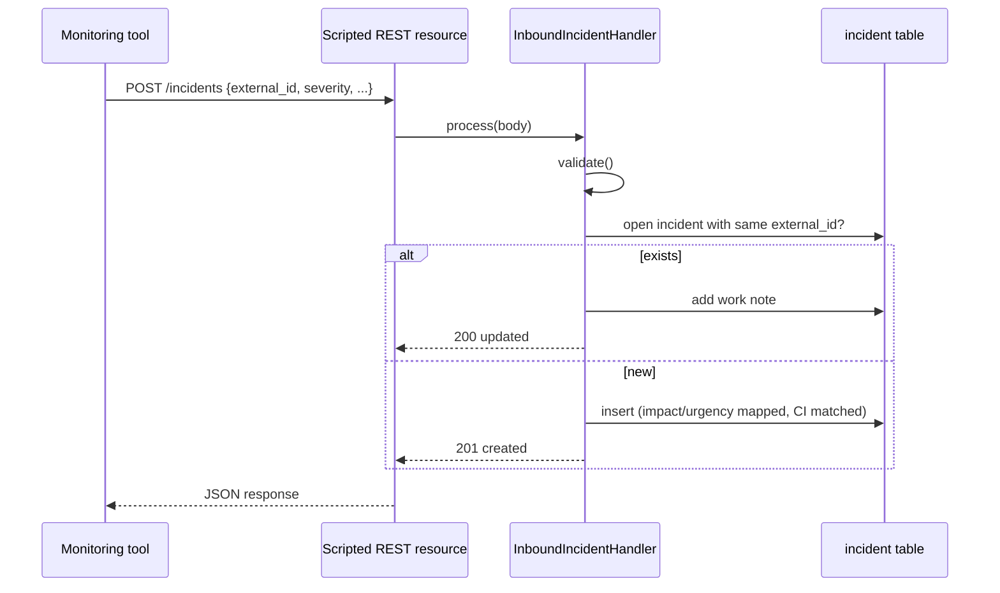

# ServiceNow REST Integration Patterns


> **Portfolio project.** This is independently written demonstration code that uses synthetic data. It is not taken from, and does not represent, any employer's or client's production code.

Two reusable building blocks for ServiceNow integrations:

1. **`ResilientRestClient`** is an outbound wrapper around `sn_ws.RESTMessageV2`. It adds retries with exponential backoff (and honors `Retry-After`), correlation IDs, secret masking, and a structured integration log.
2. **`InboundIncidentHandler`** holds the logic behind a Scripted REST API that lets monitoring or partner systems create incidents. It validates payloads, handles repeat events idempotently, maps severity to impact and urgency, and matches CIs.

## The business problem

Point-to-point integrations often fail silently. A 503 is never retried, the same alert sent twice creates duplicate incidents, and logs can expose tokens. These patterns make integrations predictable, traceable, and safe to operate.



## Outbound client behavior

| Situation | Behavior |
|---|---|
| 2xx | `ok: true`, JSON parsed when possible |
| 408 / 429 / 5xx / transport error | Retried up to `maxRetries` with exponential backoff; `Retry-After` is honored |
| Other 4xx | Not retried. The error is returned to the caller. |
| Any call | `X-Correlation-ID` header is sent. A row goes to `u_integration_log` with secrets masked. |

```javascript
var client = new ResilientRestClient({
    endpoint: gs.getProperty('x_portfolio.asset_api.endpoint'),
    credentialAlias: gs.getProperty('x_portfolio.asset_api.alias'),
    integrationName: 'asset-sync'
});
var res = client.get('assets', { updated_since: '2026-11-01' });
if (!res.ok) { /* res.error, res.status, res.correlationId */ }
```

## Sample output (synthetic alerts)

```
$ npm run demo
201  mon-0001  -> {"result":"created","number":"INC0010001","sys_id":"sys1000","ci_matched":true}
201  mon-0002  -> {"result":"created","number":"INC0010002","sys_id":"sys1001","ci_matched":false}
200  mon-0001  -> {"result":"updated","number":"INC0010001","sys_id":"sys1000"}
400  bad id!   -> {"result":"error","errors":["external_id is required ...","summary is required ...","severity must be one of: ..."]}
```

## Tech stack

ServiceNow Script Includes (ES5), Scripted REST API, `sn_ws.RESTMessageV2`, GlideRecord, system properties, and Connection & Credential aliases. Tests use the Node.js 18+ built-in test runner with Glide and REST mocks. GitHub Actions runs CI.

## Run locally

```bash
git clone https://github.com/pedapatisrujana-a11y/servicenow-rest-integration-patterns.git
cd servicenow-rest-integration-patterns
npm test        # 13 tests, no dependencies
npm run demo
```

## Install in a ServiceNow instance (PDI recommended)

1. Create the Script Includes `ResilientRestClient` and `InboundIncidentHandler` from `src/`.
2. Create a table `u_integration_log` with these fields: `u_integration`, `u_method`, `u_url`, `u_request`, `u_status` (integer), `u_attempts` (integer), `u_success` (true/false), `u_correlation_id`, and `u_error`.
3. Create a **Scripted REST API** with a `POST /incidents` resource. Use the thin wrapper shown at the top of `InboundIncidentHandler.js`, and require authentication with an integration role.
4. Set the system properties listed in `config.example.json`. Keep endpoints and credentials in properties or Connection & Credential aliases.

## Security considerations

- No credentials, instance names, or tokens are stored in this repo.
- Request bodies are masked before logging. Masked keys include password, secret, token, api_key, authorization, ssn, and credential. Query-string tokens are also masked.
- Unexpected server errors return a generic 500 response. Details go only to the system log.

## Limitations and next steps

- `gs.sleep` blocks the calling thread. For high volume, move retries to an async queue (an Event plus a Script Action, or IntegrationHub with retry policies).
- OAuth 2.0 profile support and a Flow Designer action wrapper are planned.

## License

MIT. See [LICENSE](LICENSE).
